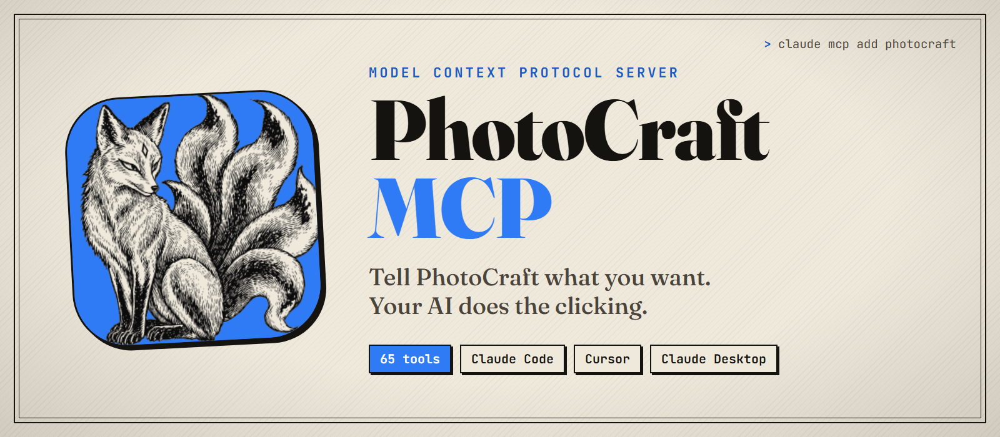
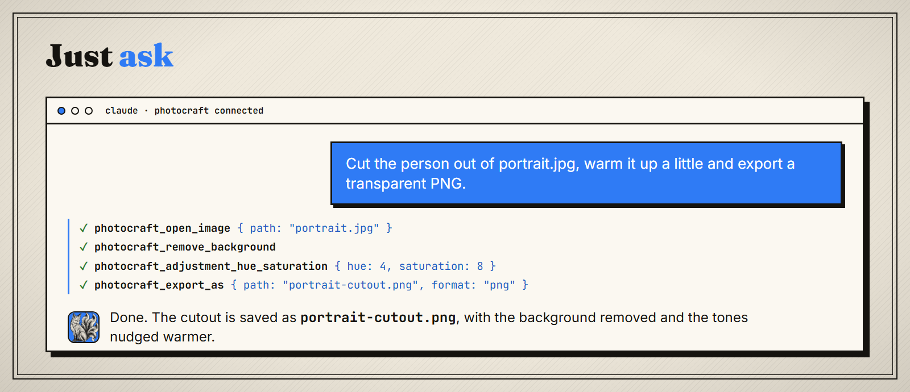
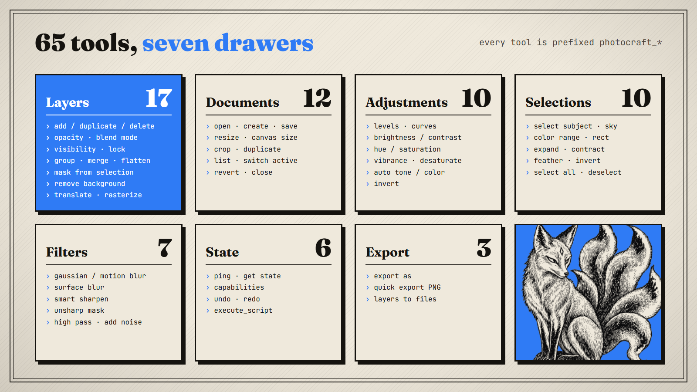
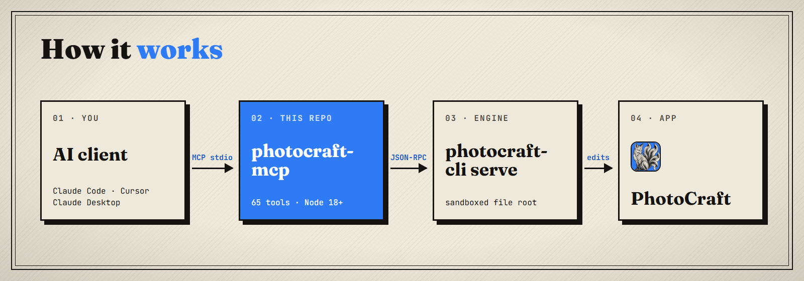

<p align="center">
  
</p>

<p align="center">
  
  
  
  
</p>

# PhotoCraft MCP

An [MCP](https://modelcontextprotocol.io) server that lets Claude, Cursor or any MCP client drive **PhotoCraft**. You describe the edit in plain words, and the AI opens files, builds layers, makes selections, applies adjustments and filters, and exports the result inside your local PhotoCraft.

<p align="center">
  
</p>

## Requirements

- **Windows** with PhotoCraft installed (default location `C:\Program Files\PhotoCraft\`)
- **Node.js 18+**
- An MCP client: Claude Code, Claude Desktop, Cursor, VS Code, …

## Install

```bash
git clone https://github.com/6reams/photocraft-mcp.git
cd photocraft-mcp
npm install
npm run build
```

This produces the server at `dist/index.js`.

## Connect your AI client

**Claude Code**

```bash
claude mcp add photocraft --scope user -- node C:/path/to/photocraft-mcp/dist/index.js
```

Start a new Claude Code session afterwards. Tools only load in sessions that start after the server is added.

**Claude Desktop, Cursor, VS Code**: add this to the client's MCP config ([example](examples/mcp-config.json)):

```json
{
  "mcpServers": {
    "photocraft": {
      "command": "node",
      "args": ["C:/path/to/photocraft-mcp/dist/index.js"],
      "env": { "LOG_LEVEL": "1" }
    }
  }
}
```

Ask your AI to *"ping PhotoCraft"*. If it answers, you're connected.

## Try saying

- *"Open `~/Pictures/beach.jpg` and select the sky, then make it a deeper blue."*
- *"Remove the background from `product.png` and export it as a transparent PNG."*
- *"Create a 1080×1920 document, add a layer, and set it to Multiply at 60% opacity."*
- *"Apply auto tone, add a bit of vibrance and sharpen with unsharp mask."*
- *"Export every layer of this document as separate PNGs into `~/Desktop/layers`."*
- *"Undo the last two steps."*

## What it can do

<p align="center">
  
</p>

<details>
<summary><b>Full tool list</b></summary>

Every tool name starts with `photocraft_`.

| Group | Tools |
| --- | --- |
| **Layers** (17) | `add_layer`, `duplicate_layer`, `delete_layer`, `rename_layer`, `select_layer`, `get_layers`, `set_layer_opacity`, `set_layer_blend_mode`, `set_layer_visibility`, `set_layer_locked`, `translate_layer`, `rasterize_layer`, `group_layers`, `merge_visible`, `flatten_image`, `add_layer_mask_from_selection`, `remove_background` |
| **Documents** (12) | `open_image`, `create_document`, `save_document`, `close_document`, `duplicate_document`, `revert_document`, `list_documents`, `set_active_document`, `get_document_info`, `resize_image`, `canvas_size`, `crop_document` |
| **Adjustments** (10) | `adjustment_levels`, `adjustment_curves`, `adjustment_brightness_contrast`, `adjustment_hue_saturation`, `adjustment_vibrance`, `auto_tone`, `auto_color`, `auto_contrast`, `desaturate`, `invert` |
| **Selections** (10) | `select_subject`, `select_sky`, `color_range_selection`, `select_rect`, `select_all`, `deselect`, `invert_selection`, `expand_selection`, `contract_selection`, `feather_selection` |
| **Filters** (7) | `gaussian_blur`, `motion_blur`, `surface_blur`, `smart_sharpen`, `unsharp_mask`, `high_pass`, `noise_add` |
| **State** (6) | `ping`, `get_state`, `get_capabilities`, `undo`, `redo`, `execute_script` |
| **Export** (3) | `export_as` (pcraft, psd, png, jpg, tif, webp, exr), `quick_export_png`, `export_layers_to_files` |

`photocraft_execute_script` runs any PhotoCraft command ID listed by `photocraft_get_capabilities`, for anything without a dedicated tool.

</details>

## How it works

<p align="center">
  
</p>

The server starts `photocraft-cli serve` as a child process and talks to it over JSON-RPC. Each MCP tool call becomes one or more PhotoCraft commands. For security, PhotoCraft only reads and writes files inside one **file root**. This defaults to your home folder and can be changed with `PHOTOCRAFT_FS_ROOT`.

| Variable | Purpose |
| --- | --- |
| `PHOTOCRAFT_PATH` | Folder containing `photocraft-cli.exe` if PhotoCraft isn't in `C:\Program Files\PhotoCraft` |
| `PHOTOCRAFT_FS_ROOT` | Folder PhotoCraft may read and write (default: your home folder) |
| `LOG_LEVEL` | `0` debug · `1` info · `2` warn · `3` error |

### Project layout

```
src/
├── index.ts          entry point
├── server.ts         MCP server, tool routing
├── logger.ts         stderr logger (stdout is reserved for MCP)
├── photocraft/       finds PhotoCraft and runs photocraft-cli serve
└── tools/            one file per tool group
```

## Troubleshooting

| Symptom | Fix |
| --- | --- |
| *PhotoCraft not found* | Install PhotoCraft, or set `PHOTOCRAFT_PATH` to its install folder |
| *Path is outside the PhotoCraft file root* | Move the file under your home folder, or set `PHOTOCRAFT_FS_ROOT` to a folder that contains it |
| Tools don't show up | Restart your AI client or start a new session after adding the server |
| Placing one image into another fails | Embedded placing is disabled in automation mode. Open the image as its own document and copy the layer across instead |
| A font isn't available | Install it in Windows first. PhotoCraft only lists installed fonts |

## Disclaimer

This is an unofficial community project and is not affiliated with the makers of PhotoCraft. The PhotoCraft name and fox logo belong to their respective owners.

## License

[MIT](LICENSE)
